 

## About

Software engineer with **6+ years of production PHP experience**, specialising in **Laravel SaaS platforms, payment integrations and WhatsApp/AI messaging systems**.

I lead the development team at **5D Solutions**: requirements, task planning, code review, release verification and production incident investigation.

I build backend systems that stay reliable under real traffic: queues, webhooks, retries and safe automation. I work in test-driven environments and care about clean MVC structure, role-based access control and code other developers can maintain.

**Highlights**

- Hands-on integration of payment gateways: Stripe, PayPal, Chargebee, NMI and Pagadito
- API development, third-party integrations and automation with Zapier and GoHighLevel (GHL)
- Custom SMTP email systems, authentication and role-based access control in Laravel
- Strong grasp of MVC architecture, RESTful APIs and event-driven systems
- Automation workflows and background job processing with Laravel Queues and Artisan commands

## Tech Stack

## What I Build

## Experience

<b>Team Lead / Software Developer</b> · 5D Solutions · <i>Jan 2025 – Present</i>

 

- Lead and manage the development team: assign tasks, track daily progress, give technical guidance
- Provide technical guidance and support to resolve development challenges
- Run code reviews to enforce coding standards and best practices
- Plan task distribution by team members' skills and project priorities
- Coordinate with the team to resolve technical issues and ensure timely project delivery
- Oversee development, testing and deployment to keep code quality and project stability high

<b>Software Developer</b> · Migastone App Development · <i>Jan 2020 – Dec 2024</i>

 

- Designed and built software solutions to solve pain points for various clients
- Fixed errors and modified existing code
- Built and maintained applications with Laravel, Zend, CodeIgniter, Vue 3, AngularJS and Bootstrap
- Worked on the Migasender and Migachat backends, payment integrations and queue jobs

<b>Assistant Network Administrator &amp; Lecturer</b> · GIMS University · <i>Oct 2017 – Dec 2019</i>

 

- Defined and implemented policies for IT equipment purchasing and usage
- Lecturer, Jan 2018 – Feb 2019

## Education &amp; Certification

- **Master of Computer Science**: PMAS-Arid Agriculture University, Rawalpindi · 2015–2017
- **BSc Computer Science**: University of Gujrat · 2012–2014
- **Huawei Certified Network Associate (HCNA)**

## Beyond Code

Badminton and table tennis.

 

